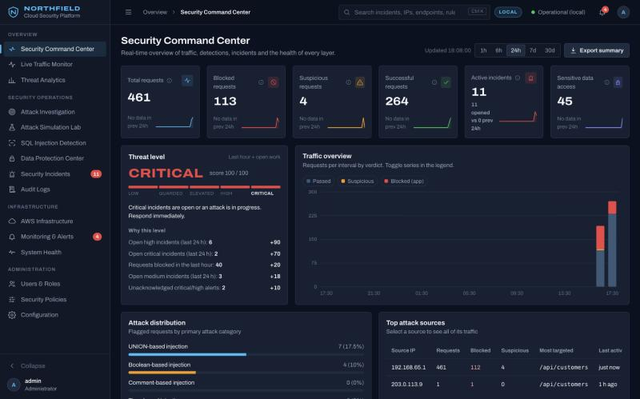
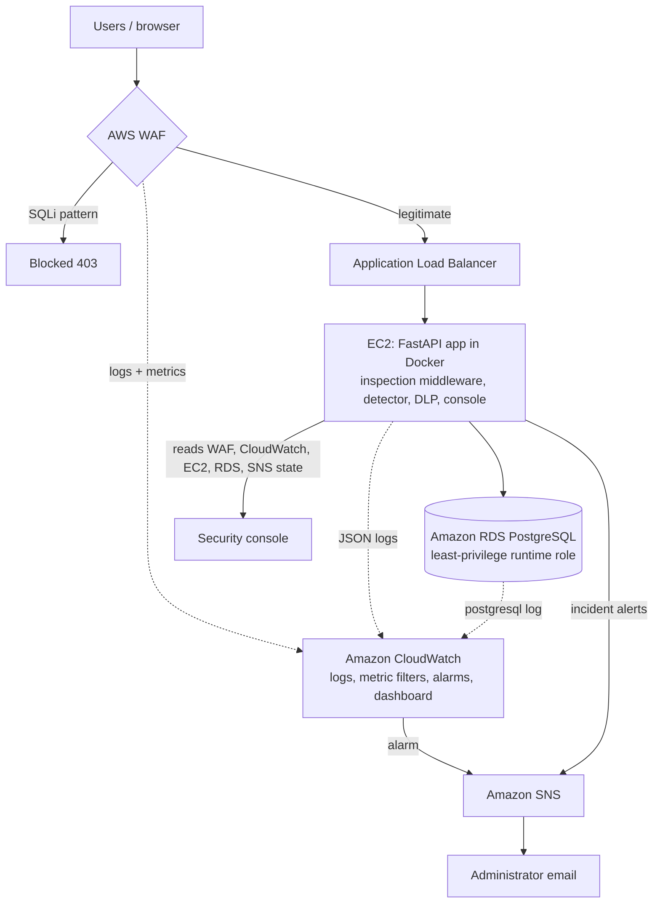
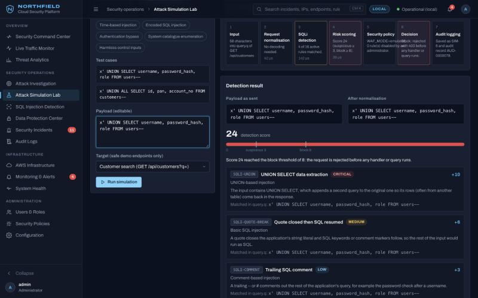
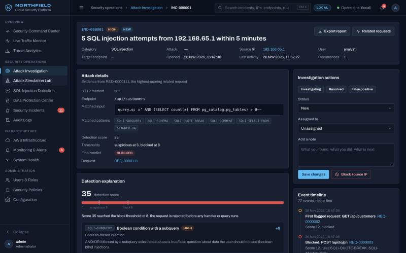
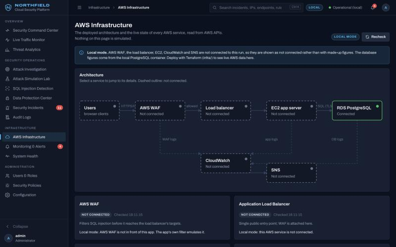
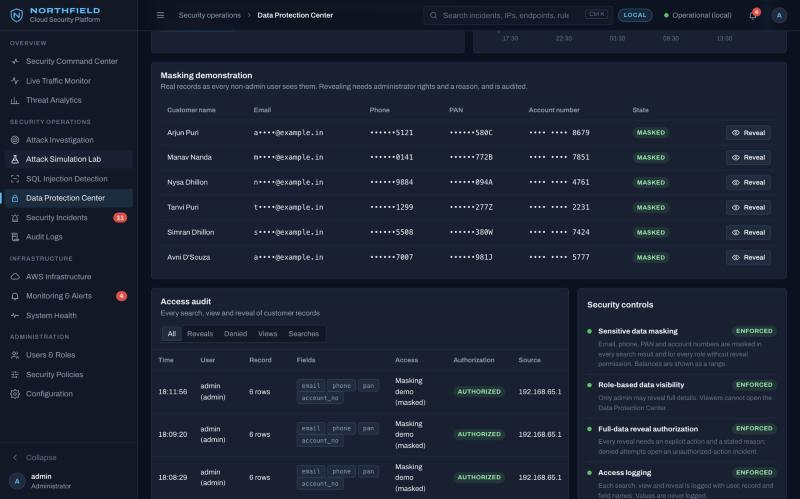

# Northfield: Cloud SQL Injection Detection and Data Leak Prevention

UCS531 Cloud Computing project, Thapar Institute of Engineering & Technology.

Northfield is a customer-records application for a fictional bank, protected by layered SQL injection defences and run from a security operations console. It deploys to AWS (WAF, ALB, EC2, RDS, CloudWatch, SNS) with Terraform, and runs fully locally with Docker, without AWS credentials.

The workflow it demonstrates end to end:

```
incoming traffic → request inspection → SQLi detection → risk scoring → blocking
→ incident generation → data protection → monitoring → investigation → audit trail → cloud alerting
```



## Contents

- [Architecture](#architecture)
- [Defence layers](#defence-layers)
- [The console](#the-console)
- [Roles and permissions](#roles-and-permissions)
- [Run locally](#run-locally)
- [Deploy to AWS](#deploy-to-aws)
- [Tests](#tests)
- [API reference](#api-reference)
- [Database and migrations](#database-and-migrations)
- [Configuration](#configuration)
- [Limitations](#limitations)

## Architecture



## Defence layers

| # | Layer | Code | What it does |
|---|-------|------|--------------|
| 1 | AWS WAF | `infra/waf.tf` | AWS managed SQLi rule set, a custom `sqli_match` rule on query, path, body and JSON values (high sensitivity, after URL/HTML decoding), known-bad-inputs set and a per-IP rate limit. Blocked requests never reach the server. |
| 2 | Application filter | `app/queryguard/detector.py`, `middleware.py` | Scores every request against 16 weighted signatures after undoing double URL-encoding, Unicode tricks and `/**/` comments. Score ≥ 8 is blocked; 3 to 7 is flagged as suspicious. Locally it stands in for WAF. |
| 3 | Parameterised queries | everywhere | All SQL uses bound parameters; `LIKE` wildcards are escaped. |
| 4 | Least-privilege DB role | `db.py`, `migrations/` | The app connects as `qg_app`. It has no DDL and no DELETE, cannot read `users.password_hash` (sign-in goes through a `SECURITY DEFINER` function), and cannot change audit records. |
| 5 | Data leak prevention | `dlp.py`, `routers/dlp.py` | Identifiers are masked in every response unless an administrator reveals a record with a stated reason, and every reveal is audited. Searches are capped at 25 rows. Bulk reading pauses the account. Database errors are never returned. |
| 6 | Response | `events.py`, `routers/incidents.py` | Incidents with workflow and deduplication, the alert center, and an administrator IP blocklist. |
| 7 | Monitoring and alerting | `infra/monitoring.tf`, `health.py`, `cloud.py` | CloudWatch metric filters, 5 alarms and a dashboard. SNS email alerts with cooldown. A background health monitor raises alerts for database outages, WAF failures and CloudWatch alarms. |

Layer 4 holds on its own. This was verified by injecting through the deliberately unsafe demo endpoint with every filter switched off:

| Injected through the unsafe endpoint | Result |
|---|---|
| `x' UNION SELECT id, pan, account_no FROM customers--` | Leaks 240 rows: layers 1 and 2 exist to stop this. |
| `x' UNION SELECT id, username, password_hash FROM users--` | `permission denied for table users` |
| `x'; DROP TABLE customers;--` | `must be owner of table customers` |
| `x'; RESET ROLE; DROP TABLE customers;--` | `must be owner of table customers` |

## The console

Sign in at `/` and the console opens at `/console`. Every page reads real data from the API, and nothing is hard-coded.

| Section | Page | What it shows / does |
|---|---|---|
| Overview | **Security Command Center** | 6 KPIs (each with comparison to the previous period, a sparkline and a tooltip); a threat level from LOW to CRITICAL, computed from real signals with the reasons listed; a traffic chart with legend toggles; attack distribution; top attack sources; a filterable, sortable incident table; system health. |
| | **Live Traffic Monitor** | Request ribbon; server-paginated request table that polls every 5 s; filters by verdict, IP and endpoint, plus search. A side panel per request shows the escaped payload, matched rules, score breakdown and verdict reason. |
| | **Threat Analytics** | Attack trends by category; blocked vs allowed traffic; top IPs and endpoints; rule performance; incident severity; DLP activity. Exports to CSV and to a Markdown activity summary. |
| Security operations | **Attack Investigation** | Per incident: overview, attack evidence, detection explanation (each rule's contribution against the thresholds), event timeline, related requests, notes. Actions: set status, assign, add notes, block the source IP, export a report. All actions are persisted and audited. |
| | **Attack Simulation Lab** | 8 attack categories plus harmless controls, or a custom payload, run through the **real detector** against designated safe targets. Shows a 7-stage pipeline with timings, score, matched rules and the recorded event. History table and side-by-side comparison of up to 4 runs. No HTTP request is sent and no SQL runs. AWS WAF is not simulated. |
| | **SQL Injection Detection** | Rule inventory with category, severity, weight, 30-day match counts and the regex pattern. Score distribution and a threshold explainer. Admins can disable or enable a rule (a reason is required, and the change is audited). |
| | **Data Protection Center** | Access KPIs, sensitive-field categories, a masking demonstration on real records with permission-controlled reveal, an access audit with authorization results, and the status of each DLP control. |
| | **Security Incidents** | Status tabs with counts; filters by severity, category and date range; search; sort; pagination; CSV export. |
| | **Audit Logs** | Append-only history with filters, plus a detail view. Analysts see operational records only. |
| Infrastructure | **AWS Infrastructure** | Architecture diagram coloured by live status. One card per service with real AWS metrics and configuration when deployed. In local mode the AWS services are shown as **not connected**; no figures are invented. |
| | **Monitoring & Alerts** | Notification center with read, acknowledge and resolve actions; deduplication counters; SNS delivery state; CloudWatch alarms. |
| | **System Health** | Live checks: API, database latency, detector self-test, DLP self-test, WAF, CloudWatch, SNS. |
| Administration | **Users & Roles** | Create users, change roles, deactivate, reset passwords. Includes the permission matrix. |
| | **Security Policies** | Thresholds behind each detector (validated ranges, a reason required, audited) and the IP blocklist. |
| | **Configuration** | Runtime configuration. Secrets show only as set or missing. |

Shell: collapsible sidebar with tooltips when collapsed, breadcrumb, global search (`Ctrl K`; searches incident IDs, IPs, endpoints, rule names, audit IDs and request IDs, filtered by role), notification bell, system status indicator, LOCAL / DEVELOPMENT / PRODUCTION badge and account menu. The customer records desk (`/records`) is the protected application itself.

| | |
|---|---|
|  |  |
|  |  |

## Roles and permissions

Every permission is enforced by the API (`security.require()`). The console only hides controls a role cannot use.

| | Admin | Security analyst | Viewer |
|---|:-:|:-:|:-:|
| Dashboards, traffic, analytics, incidents (read), infrastructure, health | ✓ | ✓ | ✓ |
| Matched payloads in traffic and incidents | ✓ | ✓ | hidden |
| Manage incidents and alerts; run simulations; export reports | ✓ | ✓ | – |
| Data Protection Center | ✓ | ✓ | – |
| Reveal unmasked customer data | ✓ | – | – |
| Audit log | all records | operational records | – |
| Users, policies, detection rules, blocklist, configuration | ✓ | view policies only | – |

A denied attempt at an admin-only action is audited and opens an *Unauthorized privileged action* incident. Changing a user's role, deactivating the account or resetting its password ends that user's existing sessions.

## Run locally

Needs Docker.

```bash
cp .env.example .env
```

```bash
docker compose up --build -d
```

Open http://localhost:8000. The local test accounts are `admin`, `analyst` and `viewer`; their passwords are in `.env`.

Generate activity so every page has data:

```bash
python3 tools/sqli_test.py --user analyst --password 'Analyst@531local'
```

```bash
python3 tools/traffic.py normal --user analyst --password 'Analyst@531local'
```

```bash
python3 tools/traffic.py scanner
```

```bash
python3 tools/traffic.py bruteforce
```

The frontend is served from `app/static`, which is mounted into the container, so page edits show up on reload. Backend changes need `docker compose up --build -d`.

## Deploy to AWS

Needs Terraform 1.5 or later, the AWS CLI, and AWS credentials (`aws configure`, or the Learner Lab credentials).

1. Create your variables file and set `alert_email`:
   ```bash
   cp infra/terraform.tfvars.example infra/terraform.tfvars
   ```
   On **AWS Academy Learner Lab**, also set `existing_instance_profile_name = "LabInstanceProfile"`, because Learner Lab cannot create IAM roles.
2. Create everything (10 to 15 minutes; RDS is the slow part):
   ```bash
   cd infra && terraform init && terraform apply
   ```
3. **Confirm the SNS subscription** from the email AWS sends. Alerts do not arrive until you do.
4. Get the URL and passwords:
   ```bash
   terraform output console_url
   ```
   ```bash
   terraform output -raw admin_password
   ```
   The app needs 3 to 5 minutes after `apply` to build its container and pass health checks.
5. Test through AWS WAF:
   ```bash
   python3 tools/sqli_test.py --target "$(terraform output -raw app_url)"
   ```
   Most payloads now report `blocked by AWS WAF`. The console's AWS Infrastructure page shows the Web ACL, WAF metrics, EC2 and RDS state, alarms and SNS subscriptions, all read live from AWS.

On AWS the app runs with `APP_ENV=production`, which refuses the unsafe demo endpoint and `WAF_MODE=off`. The instance role is limited to what the app uses: reading its own bundle, its secrets and the RDS master secret; publishing to its SNS topic; and read-only WAF, CloudWatch, EC2 and RDS state.

**Cost:** roughly USD 1 to 2 per day outside the free tier, mostly the load balancer and WAF. Destroy everything after the demo:

```bash
cd infra && terraform destroy
```

## Tests

Results from the last run on this branch:

| Suite | Command | Result |
|---|---|---|
| Unit: detector, categories, explanations, masking, middleware redaction, RBAC map | `pytest tests --ignore=tests/integration` | **48 passed** |
| Integration: API, PostgreSQL, detector, incidents, DLP, audit, RBAC, CSRF, sessions, health | see below | **25 passed** |
| Attack suite: 14 payloads × 2 endpoints, plus 4 harmless controls | `python3 tools/sqli_test.py` | **28/28 blocked, 0 false positives** |
| Terraform | `terraform validate` | **valid** |
| Console pages | loaded every route in a browser and checked for render and JS errors; exercised the simulation lab, investigation, DLP reveal and mobile layout | no errors |

Run the unit tests:

```bash
docker run --rm -v "$PWD/app":/srv -w /srv python:3.12-slim sh -c "pip install -q -r requirements-dev.txt && python -m pytest -q tests --ignore=tests/integration"
```

Run the integration tests against the running stack. The two database-level tests also need `DB_ADMIN_DSN` and `DB_APP_DSN`; they are skipped without them:

```bash
docker run --rm --network cloud-sqli-detection_default -v "$PWD/app":/srv -w /srv -e BASE_URL=http://app:8000 python:3.12-slim sh -c "pip install -q -r requirements-dev.txt && python -m pytest -q tests/integration"
```

There is no automated browser test suite. The console was checked by loading every route and exercising the main flows in a browser, as recorded above.

## API reference

All endpoints return JSON and require a session unless noted. State-changing calls also need the `X-Northfield-CSRF: 1` header.

| Area | Endpoints |
|---|---|
| Auth | `POST /api/login` (public), `POST /api/logout`, `GET /api/me`, `GET /api/config` (public, minimal) |
| Records (unchanged) | `GET /api/customers?q=`, `GET /api/customers/{id}[?reveal=true]` |
| Command center | `GET /api/soc/overview?hours=1\|6\|24\|168\|720`, `GET /api/admin/overview` (original endpoint, kept) |
| Traffic | `GET /api/traffic?verdict=&ip=&endpoint=&q=&since_id=&page=&page_size=`, `GET /api/traffic/{id}` |
| Analytics and search | `GET /api/analytics?hours=`, `GET /api/search?q=` |
| Exports | `GET /api/export/requests.csv`, `GET /api/export/incidents.csv`, `GET /api/export/summary.md`, `GET /api/incidents/{id}/report` |
| Incidents | `GET /api/incidents` (filters, sort, pagination), `GET /api/incidents/{id}`, `PATCH /api/incidents/{id}` (status, assignee, note) |
| Blocklist | `GET /api/blocklist`, `POST /api/blocklist`, `DELETE /api/blocklist/{ip}` |
| Alerts | `GET /api/alerts`, `POST /api/alerts/{id}` (`read`, `acknowledge`, `resolve`), `POST /api/alerts/read-all` |
| Detection | `GET /api/detection/rules`, `GET /api/detection/stats`, `PATCH /api/detection/rules/{id}` |
| Simulation lab | `GET /api/simulations/presets`, `POST /api/simulations` (base64 payload), `GET /api/simulations` |
| DLP | `GET /api/dlp/overview`, `GET /api/dlp/sample`, `POST /api/dlp/reveal`, `GET /api/dlp/access` |
| Administration | `GET/POST /api/users`, `PATCH /api/users/{id}`, `POST /api/users/{id}/password`, `GET /api/users/assignable`, `GET /api/audit`, `GET /api/audit/{id}`, `GET/PUT /api/policies`, `GET /api/admin/config` |
| Health and infrastructure | `GET /health` (public), `GET /api/health/components`, `GET /api/infra` |

## Database and migrations

Migrations live in `app/queryguard/migrations/` and are applied in order at start-up by the bootstrap login. They are recorded in `schema_migrations`.

- `001_base.sql`: the original schema (`users`, `customers`, `request_log`, `security_event`, `auth_lookup`).
- `002_soc.sql`:
  - **Viewer role and account state:** viewer role, `is_active`, `last_login_at`, `session_epoch` for session revocation.
  - **Request detail:** user agent, query preview, category and per-match detail on `request_log`.
  - **Incident workflow:** status, assignee, occurrences, last activity and the expanded severity scale on `security_event`.
  - **New tables:** `incident_note`, `security_alert`, `audit_log` (a trigger rejects UPDATE/DELETE), `dlp_access` (field names only), `blocked_source`, `security_policy`, `rule_state`, `simulation_run`.
  - **Indexes and backfill:** new indexes for the console's queries, and a backfill of categories for incidents recorded before the migration.

Existing databases upgrade in place. The local database used during development went through it with its data intact.

## Configuration

| Variable | Default | Meaning |
|---|---|---|
| `APP_ENV` | `local` | `local`, `development` or `production`. Production refuses `WAF_MODE=off` and the unsafe demo. |
| `WAF_MODE` | `emulated` | `aws`: WAF is in front and the app reads WAF metrics. `emulated`: the app blocks like WAF. `off`: classify only. |
| `TRUST_PROXY` | `false` | Use the right-most `X-Forwarded-For` entry (set by the ALB) as the client IP. |
| `ENABLE_VULNERABLE_DEMO` | `false` | Adds `/api/demo/unsafe-search`. Local controlled demo only. |
| `VIEWER_PASSWORD` | unset | Seeds the read-only `viewer` account when set. |
| `REPEAT_ATTACK_THRESHOLD`, `FAILED_LOGIN_THRESHOLD`, `RECORD_VIEW_THRESHOLD`, `SEARCH_THRESHOLD`, `LOCKOUT_SECONDS`, `ALERT_COOLDOWN_SECONDS`, `API_RATE_LIMIT`, `DETECTION_WINDOW_SECONDS` | see `config.py` | Defaults for the security policies. Administrators can change them at runtime under Security Policies. |
| `EC2_INSTANCE_ID`, `DB_INSTANCE_ID`, `ALB_ARN_SUFFIX`, `TARGET_GROUP_ARN_SUFFIX`, `APP_LOG_GROUP`, `ALARM_PREFIX` | unset | Set by Terraform; used by the infrastructure monitor. |

No dependencies were added for the upgrade. The console is plain ES modules with hand-drawn SVG charts, so it needs no build step and no CDN (apart from the Archivo web font).

## Limitations

- **Single app instance.** Sliding-window counters (brute force, bulk access, repeat attacks, rate limit) live in memory: they reset on restart and are not shared between instances. Scaling out would need Redis or DynamoDB for them. Incidents, alerts, policies and the blocklist are already in PostgreSQL.
- **HTTP only.** Add an ACM certificate and an HTTPS listener, then set `COOKIE_SECURE=true`.
- **Signatures, not learning.** Novel payloads can get past layers 1 and 2; layers 3 to 5 make that survivable.
- **Requests blocked by AWS WAF never reach the app.** They appear as WAF totals and samples (WAF keeps samples for 3 hours), not in the request table.
- **EC2 memory is not reported.** It needs the CloudWatch agent, which this deployment does not install.
- **No per-user notification preferences.** Alert routing is SNS topic-wide.
- **The AWS integration paths are written but untested.** They are implemented against the AWS APIs, but this upgrade was tested in local mode only; they have not been run against a live deployment.
- **Testing scope.** Run injection tests only against your own deployment, in the controlled test environment.
