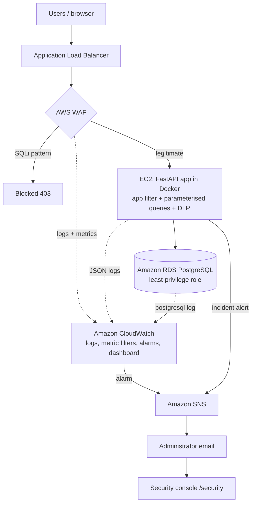

# Cloud-Based SQL Injection Detection and Data Leak Prevention System

UCS531 Cloud Computing project, Thapar Institute of Engineering & Technology.

A customer-records web app for a fictional bank ("Northfield"). It runs on AWS behind layered SQL injection defences, with monitoring, automated alerts and an admin security console.



## Defence layers

| # | Layer | Where | What it stops |
|---|-------|-------|---------------|
| 1 | AWS WAF | `infra/waf.tf` | AWS managed SQLi rule set, a custom `sqli_match` rule on query, path, body and JSON values (high sensitivity, after URL/HTML decoding), known-bad-inputs set, per-IP rate limit. Blocked requests never reach the server. |
| 2 | Application filter | `app/queryguard/detector.py`, `middleware.py` | Scores every request against 16 weighted signatures after undoing double URL-encoding, Unicode tricks and `/**/` comments. Score 8 or more is blocked, 3 to 7 is flagged as suspicious. Locally it stands in for WAF. |
| 3 | Parameterised queries | `app/queryguard/main.py` | All SQL uses bound parameters. Input is never part of the SQL text. |
| 4 | Least-privilege DB role | `app/queryguard/db.py`, `schema.sql` | The app connects as `qg_app`: no DDL, no DELETE, no access to `users.password_hash` (login goes through a `SECURITY DEFINER` function). |
| 5 | Data leak prevention | `app/queryguard/dlp.py` | Emails, phones, PAN and account numbers are masked. Only admins can unmask a record, and each unmask is logged. Searches return at most 25 rows. Heavy reading pauses the account and raises an alert. Database errors are never returned to the client. |
| 6 | Monitoring and alerting | `infra/monitoring.tf`, `app/queryguard/events.py` | CloudWatch collects WAF, app and RDS logs. Metric filters, alarms and a dashboard sit on top. SNS emails the admin. The app also sends detailed incident alerts: repeated injection, brute force, bulk access. |

The proof that layer 4 works on its own was run against the deliberately unsafe demo endpoint with every filter switched off:

| Injected through the unsafe endpoint | Result |
|---|---|
| `x' UNION SELECT id, pan, account_no FROM customers--` | Leaks 240 rows. Layers 1 and 2 exist to stop this. |
| `x' UNION SELECT id, username, password_hash FROM users--` | `permission denied for table users` |
| `x'; DROP TABLE customers;--` | `must be owner of table customers` |
| `x'; RESET ROLE; DROP TABLE customers;--` | `must be owner of table customers` |

## Repository layout

```
app/                 FastAPI app (Docker image)
  queryguard/        backend: detector, middleware, DLP, DB bootstrap, alerts, WAF metrics
  static/            login, records and security console pages (no build step)
  tests/             detector and masking tests
infra/               Terraform: VPC, ALB, WAF, EC2, RDS, CloudWatch, SNS
tools/sqli_test.py   sends known payloads plus harmless controls, reports what was blocked
tools/traffic.py     demo traffic: normal use, brute force, bulk access, scanner
docker-compose.yml   local run (PostgreSQL + app, WAF emulated)
```

## Run locally

Needs Docker.

```bash
cp .env.example .env
```

```bash
docker compose up --build -d
```

Open http://localhost:8000. Sign in as `admin` or `analyst`; the passwords are in `.env`.

Exercise the defences:

```bash
python3 tools/sqli_test.py --user analyst --password 'Analyst@531local'
```

```bash
python3 tools/traffic.py normal --user analyst --password 'Analyst@531local'
```

```bash
python3 tools/traffic.py bruteforce
```

```bash
python3 tools/traffic.py scanner
```

Then open http://localhost:8000/security as admin.

Run the unit tests:

```bash
docker run --rm -v "$PWD/app":/srv -w /srv python:3.12-slim sh -c "pip install -q -r requirements-dev.txt && python -m pytest -q"
```

## Deploy to AWS

Needs Terraform 1.5 or later, the AWS CLI, and AWS credentials (`aws configure`, or the Learner Lab credentials).

1. Create your variables file and set `alert_email`:
   ```bash
   cp infra/terraform.tfvars.example infra/terraform.tfvars
   ```
   On **AWS Academy Learner Lab**, also set `existing_instance_profile_name = "LabInstanceProfile"`, because Learner Lab does not allow creating IAM roles.
2. Create everything (about 10 to 15 minutes; RDS is the slow part):
   ```bash
   cd infra && terraform init && terraform apply
   ```
3. Open the email from AWS Notifications and **confirm the SNS subscription**. Alerts do not arrive until you do.
4. Get the URL and passwords:
   ```bash
   terraform output app_url
   ```
   ```bash
   terraform output -raw admin_password
   ```
   The app needs 3 to 5 minutes after `apply` to build its container and pass load balancer health checks.
5. Test through AWS WAF:
   ```bash
   python3 tools/sqli_test.py --target "$(terraform output -raw app_url)"
   ```
   The result column should now say `blocked by AWS WAF` for most payloads. The security console's "Blocked at AWS WAF" section and the CloudWatch dashboard (`terraform output cloudwatch_dashboard_url`) show the same requests.

To change the app, edit files under `app/` and run `terraform apply` again. A new app bundle replaces the EC2 instance.

### Cost and clean-up

Outside the free tier this costs very roughly USD 1 to 2 per day. The load balancer and WAF are most of that. RDS `db.t4g.micro` and EC2 `t3.micro` are free-tier eligible. Destroy everything after the demo:

```bash
cd infra && terraform destroy
```

## Suggested demo (viva)

1. Show the architecture diagram above and the AWS resources in the console: ALB, Web ACL, EC2, RDS, log groups, alarms, SNS topic.
2. Sign in as `analyst`. Search `Sharma` and open a record: identifiers are masked. Search `D'Souza`: a legitimate apostrophe passes.
3. Type `' OR 1=1--` into search: AWS WAF blocks it.
4. Run `tools/sqli_test.py` against the ALB: 28 out of 28 payloads blocked, no false positives.
5. Run `tools/traffic.py scanner` and `bruteforce`: show the SNS emails arriving, the CloudWatch alarms in ALARM state and the dashboard.
6. Sign in as `admin` and open the security console: the request ribbon, the counts, the incidents and WAF's sampled requests.
7. Optional, local only: set `WAF_MODE=off` and `ENABLE_VULNERABLE_DEMO=true` in `.env`, restart, and use the "Unprotected search" box on the records page. A UNION query leaks PII, but password hashes and `DROP TABLE` are still refused by the database role.

## Configuration

| Variable | Default | Meaning |
|---|---|---|
| `WAF_MODE` | `emulated` | `aws`: WAF is in front, the app reads WAF metrics. `emulated`: the app blocks like WAF. `off`: classify only, never block. |
| `TRUST_PROXY` | `false` | Use the right-most `X-Forwarded-For` entry (set by the ALB) as the client IP. |
| `ENABLE_VULNERABLE_DEMO` | `false` | Adds `/api/demo/unsafe-search`. Controlled demo only. |
| `REPEAT_ATTACK_THRESHOLD` | `5` | Injection attempts from one IP in the window before an incident is raised. |
| `FAILED_LOGIN_THRESHOLD` | `5` | Failed sign-ins from one IP before an incident is raised. |
| `RECORD_VIEW_THRESHOLD` | `25` | Record views per user in the window before access is paused. |
| `DETECTION_WINDOW_SECONDS` | `300` | Sliding window for the counters above. |
| `ALERT_COOLDOWN_SECONDS` | `300` | Minimum gap between alerts for the same source. |

## Limits

- One app instance. The sliding-window counters are in memory, so they reset on restart and are not shared between instances. Running several instances would need Redis or DynamoDB for those counters.
- HTTP only: no domain or certificate. Add an ACM certificate and an HTTPS listener, then set `COOKIE_SECURE=true`.
- Signature detection catches known patterns. Novel payloads can get past layers 1 and 2. Layers 3 to 5 make that survivable.
- Run injection tests only against your own deployment, in the controlled test environment.
